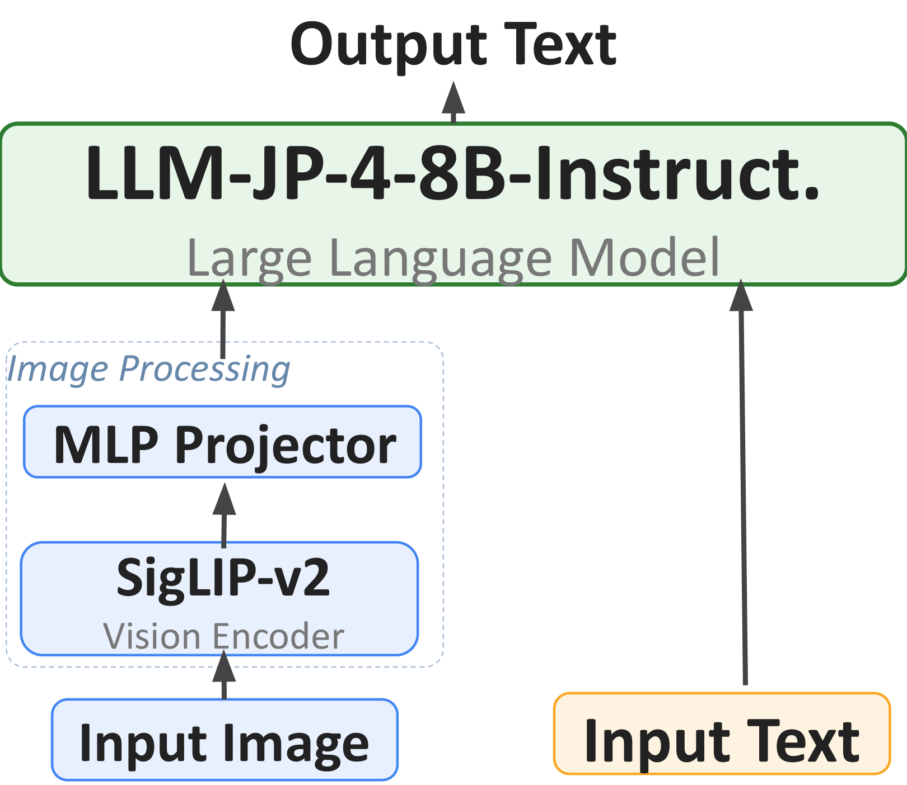

> **Status:** Accepted at the **Continual Adaptation at Scale: Towards Sustainable AI (CATS) Workshop @ ICML 2026** ([workshop site](https://cats-icml.github.io/)).
>
> **GitHub Repository:** [https://github.com/AtsushiYanaigsawa768/Compass](https://github.com/AtsushiYanaigsawa768/Compass)
>
> **HuggingFace Collection:** [https://huggingface.co/collections/Yana/compass](https://huggingface.co/collections/Yana/compass)
>
> **Previous (legacy) version of this post — FT-LLM 2026 free-form task write-up:** [Compass (FT-LLM 2026 version)](/mysite/blog/compass-ft-llm-2026/)

This post supersedes the earlier FT-LLM 2026 write-up. The earlier post described the same model under the framing of the FT-LLM 2026 free-form task; the present post re-frames the same pipeline as a study of **staged continual adaptation** for the CATS workshop at ICML 2026, adds an un-fine-tuned **Phase 0 (P0) baseline**, reports comparisons against external models (Llama-3.3-70B, GPT-5, DeepSeek-R1, Qwen-2/3, Claude 3.5 Sonnet), and updates the per-task analysis. The previous numbers and discussion remain available at the link above for reference.

This research was carried out by [Atsushi Yanagisawa](https://atsushiyanaigsawa768.github.io/mysite/en/) and [Genshin Kakimoto](https://github.com/kakimoto0225).

---

## Introduction

Adapting a multimodal foundation model to a specialised domain rarely proceeds in a single step: contemporary recipes chain together vision–language alignment, reasoning distillation, and domain tuning, and each stage can both install new capabilities and erode previously acquired ones. LLaVA-style recipes [1, 12] establish the architectural template for such multi-stage adaptation but say little about how earlier phases interact with later ones when the target domain demands structured prediction beyond free-form QA. We ask:

> **Do the phases of a staged adaptation pipeline contribute monotonically, or does staging induce capability trade-offs whose best checkpoint differs by task?**

We study this through a three-phase **staged continual adaptation** pipeline — vision–language alignment, mathematical reasoning distillation, financial-domain adaptation — on an 8.4B-parameter model pairing SigLIP-v2 [15] with llm-jp-4-8B-Instruct via a two-layer MLP projector [1, 12]. The un-fine-tuned instruction baseline serves as **Phase 0 (P0)** so each phase's contribution is measured against a common reference.

- **Phase 1 (P1)** aligns visual and language representations using existing Japanese captioning/VQA corpora together with OCR and visual QA we synthesise from PDFs published by Japanese government agencies — the Cabinet Office, the Financial Services Agency (FSA), and the Ministry of Finance (MOF).
- **Phase 2 (P2)** distils chain-of-thought from Qwen3-30B-A3B-Thinking-2507 [2]; we include this phase because solving real-world financial tasks requires a non-trivial level of numerical reasoning.
- **Phase 3 (P3)** consumes text-only financial benchmarks [4, 5, 8] together with visual QA we construct from financial documents to instil financial knowledge directly from those documents.

As Japanese-language testbeds we adopt **EDINET disclosures** [13] and **JP Fin Harness** [14] — EDINET measures performance on real-world financial tasks, while JP Fin Harness probes finance knowledge in Japanese — and additionally use **GSM8K** [9] to measure mathematical ability. **Different benchmarks peak at different phases.**

**Contributions:**

1. An empirical characterisation of phase-dependent capability trade-offs on EDINET and JP Fin Harness, anchored to the un-fine-tuned baseline so each phase's contribution is decomposable.
2. A three-phase *staged continual adaptation* pipeline operating end-to-end on page images.
3. A reproducible synthetic-data pipeline generating OCR, visual QA, and domain-specific financial QA from government PDFs, to be released publicly.
4. An XML-structured chain-of-thought distillation recipe from Qwen3-30B-A3B-Thinking-2507 [2].

---

## Architecture

The model consists of three components: a vision encoder, an MLP projector, and a language model.



- **Vision encoder.** [SigLIP-v2 SO400M-patch14-384](https://huggingface.co/google/siglip2-so400m-patch14-384) [15], producing 729 patches per image (27 × 27 grid at 384 × 384 input).
- **Projector.** A two-layer MLP `Linear(1152 → 4096) → GELU → Linear(4096 → 4096)` (~8M parameters) bridging visual and linguistic representations.
- **Language model.** **llm-jp-4-8B-Instruct**, an 8B Japanese-pretrained model with hidden dimension 4,096. Together with the vision encoder the total parameter count is approximately **8.4B**.

Unlike LLaVA-OneVision we do **not** adopt AnyRes multi-resolution processing; each image is processed as a single 384 × 384 crop (729 vision tokens), trading some resolution for compute. See the [legacy post](/mysite/blog/compass-ft-llm-2026/) for the detailed comparison table.

---

## Data Generation from Government PDFs

The synthetic supervision at the core of this study comes from two sources: publicly available PDFs issued by Japanese government agencies — the Cabinet Office, FSA, and MOF — and publicly available math corpora. We chose these three agencies because they publish a large volume of finance-related materials.

From the government PDFs we construct three single-page datasets using **Qwen3-VL-32B-Instruct** as the teacher:

1. **OCR dataset** — text transcription of each page (motivated by LLaVAR [12]).
2. **Extractive + reasoning VQA dataset** — first turn extracts a specific element from the page; second turn asks for the evidence grounding that answer (motivated by LLaVAR-2 [11]).
3. **Finance-specific QA dataset** — questions tied to each page, ranging from simple extraction to multi-step numerical computation. For this dataset we manually identify finance-relevant sub-sites within the Cabinet Office, FSA, and MOF web presences and restrict source PDFs to those sub-sites.

### Math Reasoning Distillation Corpus

For the math reasoning dataset we draw problems from six publicly available math corpora — MGSM-ja, MathInstruct, OpenMathReasoning, OpenR1-Math-220k, orca-math-word-problems-200k, and NuminaMath-1.5 — and randomly sample **150K problems in total**. Each sampled problem is re-annotated by prompting Qwen3-30B-A3B-Thinking-2507 [2] to emit its response inside `<Problem>`, `<Thinking>`, and `<Answer>` tags. This XML format localises intermediate-reasoning errors and fits the multi-step numerical reasoning common in financial documents.

```xml
<Problem>Restatement of the problem in the model's own words</Problem>
<Thinking>Step-by-step reasoning with intermediate calculations</Thinking>
<Answer>\boxed{final numerical answer}</Answer>
```

### Dataset Sizes

| Phase | Type | Content | Examples | Type total |
|-------|------|---------|---------:|-----------:|
| P1-S1 | OCR / Caption | STAIR Captions [3] | 820,310 | **1,084,952** |
| P1-S1 | OCR / Caption | OCR from government PDFs (synthesised) | 264,642 | |
| P1-S2 | VQA | Extractive + reasoning QA from government PDFs | 264,642 | **365,137** |
| P1-S2 | VQA | JA-VG-VQA conversational | 99,995 | |
| P1-S2 | VQA | JA-VG-VQA-500 | 500 | |
| P2-S1 | Reasoning SFT | Random sample across MGSM-ja, MathInstruct, OpenMathReasoning, OpenR1-Math-220k, Orca-Math-200k, NuminaMath-1.5 | ~150,000 | **~150,000** |
| P3-S1 | Financial QA | FinQA [5] + ConvFinQA [4] + TAT-QA [8] | 23,358 | **23,358** |
| P3-S2 | Visual Financial QA | Domain-specific QA from government PDFs | 32,484 | **32,484** |

---

## Three-Phase Staged Continual Adaptation

Training proceeds in three phases, with the un-fine-tuned instruction-tuned llm-jp-4-8B-Instruct serving as P0.

| Phase | Modules Updated | Primary Objective |
|-------|-----------------|-------------------|
| **P1-S1** | Projector only | Alignment of image and language embeddings (vision and LLM frozen) |
| **P1-S2** | Vision + Projector + LLM (LoRA r=64) | Visual instruction following in Japanese |
| **P2-S1** | LLM (QLoRA r=32, 4-bit NF4) | Chain-of-thought distillation for math reasoning |
| **P3-S1** | LLM (LoRA r=16) | Text-only financial-domain adaptation |
| **P3-S2** | Projector + LLM (LoRA r=16) | Visual domain QA on government financial documents |

**Why this ordering?**

- **P1 is required** because the pretrained LLM has no prior exposure to image tokens from SigLIP-v2's embedding space.
- **P2 is motivated** by the observation that financial documents require multi-step numerical deduction (e.g., consistency checks across tables).
- **P3 re-introduces** domain-specific supervision, as general-purpose math distillation does not cover financial terminology or reporting conventions.

### Training Hyperparameters

| Stage | LR | Batch | LoRA (r, α) | Epochs |
|-------|----|-------|-------------|--------|
| P1-S1 | 1e-3 | 2 | None (projector only) | 2 |
| P1-S2 | 2e-5 | 2 | 64, 128 | 1 |
| P1-S2B (LLM) | 1e-5 | 2 | 64, 128 | 1 |
| P1-S2B (Vision) | 2e-6 | 2 | 64, 128 | 1 |
| P2-S1 (SFT, QLoRA) | 2e-4 | 2 | 32, 64 | 1 |
| P3-S1 / P3-S2 | 5e-6 | 2 | 16, 32 | 3 |

All stages use AdamW with cosine schedule and warmup. Gradient checkpointing is enabled on memory-intensive stages.

### Training Loss Curves


---

## Experimental Results

### Per-Phase Evaluation (Anchored to P0)

The key empirical claim of this paper is that **each benchmark peaks at a different phase** when measured against the un-fine-tuned baseline.

| Benchmark | **P0** | **P1** | **P2** | **P3** |
|-----------|:------:|:------:|:------:|:------:|
| GSM8K | 58.5 | 64.6 | **73.2** | 71.9 |
| EDINET earnings† | 0.524 | **0.532** | 0.500 | 0.458 |
| EDINET fraud† | 0.516 | 0.472 | 0.534 | **0.580** |
| EDINET industry | 4.7 | **8.5** | 6.9 | 6.5 |
| JP Fin Harness | 45.0 | **54.2** | 31.6 | 49.6 |

† ROC-AUC. Others are Accuracy (%). **Bold** = best phase per row.

- **P0 → P1** raises JP Fin Harness (45.0 → 54.2), GSM8K (58.5 → 64.6), and EDINET industry (4.7 → 8.5); EDINET earnings is essentially unchanged; **EDINET fraud is the only benchmark that drops** (0.516 → 0.472).
- From **P1**, GSM8K continues to rise to **73.2 at P2** before slipping to 71.9 at P3; **EDINET fraud recovers at P2 (0.534) and peaks at P3 (0.580)**.
- The remaining three benchmarks all **decline past P1**: JP Fin Harness (54.2 → 31.6 → 49.6), EDINET earnings (0.532 → 0.500 → 0.458), EDINET industry (8.5 → 6.9 → 6.5).
- Relative to P0, **P3 lies above P0 on four of five benchmarks** and below P0 only on EDINET earnings (0.458 vs. 0.524).

### Per-Task JP Fin Harness Breakdown

| JP Fin task | P0 | P1 | P2 | P3-1 | P3-2 |
|-------------|:--:|:--:|:--:|:----:|:----:|
| chabsa | 0.8591 | **0.9428** | 0.5818 | 0.9357 | 0.9356 |
| cma_basics | 0.3421 | **0.5526** | 0.2105 | 0.3947 | 0.3947 |
| cpa_audit | **0.2764** | 0.2261 | 0.1683 | 0.2487 | 0.2362 |
| fp2 | 0.2989 | **0.3389** | 0.1789 | 0.2863 | 0.2989 |
| security_sales_1 | 0.4737 | **0.6491** | 0.4386 | 0.5614 | 0.6140 |
| **Average** | 0.4500 | **0.5419** | 0.3156 | 0.4854 | 0.4959 |

Subtask behaviour is heterogeneous: the P0 → P1 gain is concentrated on **chabsa**, **cma_basics**, and **security_sales_1**. From P1, every subtask drops at P2 and only **partially** recovers at P3. **cpa_audit** is the only task whose best score is at **P0** (0.276) — neither P1 nor P3 recovers it.

---

## Comparison with External Models

### EDINET

Llama-3.3-70B is evaluated under the same setup as ours; GPT-5 and DeepSeek-R1 numbers are taken from EDINET-Bench [13] for context only (cross-source, indicative rather than head-to-head).

| Benchmark | Llama-3.3-70B | GPT-5 | DeepSeek-R1 | **Ours (P3)** |
|-----------|:-------------:|:-----:|:-----------:|:-------------:|
| EDINET earnings† | 0.410 | **0.580** | 0.430 | 0.458 |
| EDINET fraud† | **0.590** | 0.560 | 0.540 | 0.580 |
| EDINET industry | 14.0 | **21.0** | 11.0 | 6.5 |

- On **EDINET fraud**, our 0.580 is within 0.01 of Llama-3.3-70B (0.590), despite using only **8.4B parameters vs. 70B**.
- On **EDINET earnings**, both our P1 peak (0.532) and our P3 checkpoint (0.458) exceed Llama-3.3-70B (0.410) and DeepSeek-R1 (0.430), while trailing GPT-5 (0.580).
- **EDINET industry** is a clear weakness: our 6.5 trails every external baseline (11.0 – 21.0).

### JP Fin Harness

External scores are from the official 0-shot leaderboard [14].

| Model | Size | Avg. |
|-------|:----:|:----:|
| Claude 3.5 Sonnet | proprietary | **77.0** |
| Qwen2-72B-Instruct | 72B | 67.7 |
| Qwen-14B-Chat | 14B | 49.1 |
| Meta-Llama-3-8B-Instruct | 8B | 44.7 |
| **Ours (P0)** | 8B | 45.0 |
| **Ours (P1)** | 8B | **54.2** |
| **Ours (P3)** | 8B | 49.6 |

Our **P1** (54.2) exceeds Meta-Llama-3-8B-Instruct (44.7) and Qwen-14B-Chat (49.1) but trails Qwen2-72B-Instruct (67.7) and Claude 3.5 Sonnet (77.0); our **P3** (49.6) is roughly at Qwen-14B-Chat parity.

### GSM8K

Some math corpora used at P2 include GSM8K-style problems, so the comparison includes a degree of in-distribution fine-tuning.

| Model | GSM8K |
|-------|:-----:|
| Qwen-14B Chat | 59.3 |
| Qwen3 8B-base | **89.84** |
| Llama 3 8B | 84.5 |
| Gemma 3 4B | 89.2 |
| Ours (P0) | 58.5 |
| Ours (P1) | 64.6 |
| **Ours (P2)** | **73.2** |
| Ours (P3) | 71.9 |

Our P2 (73.2) exceeds Qwen-14B Chat (59.3) but remains 11–17 points below Llama 3 8B (84.5), Gemma 3 4B (89.2), and Qwen3 8B-base (89.84).

---

## Discussion

### Capability trajectories, not endpoints

No benchmark in our suite follows a flat trajectory: the **best phase varies by benchmark**. JP Fin Harness, EDINET earnings, and EDINET industry peak at **P1** (54.2 / 0.532 / 8.5); GSM8K peaks at **P2** (73.2); EDINET fraud peaks at **P3** (0.580). EDINET fraud is also the only benchmark that drops at P0 → P1 (0.516 → 0.472) before recovering.

Deployment checkpoint selection is therefore task-dependent: **P1** for Japanese financial-domain priors, **P2** for math, **P3** for fraud detection. We treat staged continual adaptation as a *trajectory* anchored to P0 rather than a single endpoint.

### Why P1 → P2 erodes financial scores

JP Fin Harness drops sharply at P1 → P2 (54.2 → 31.6), and EDINET earnings (0.532 → 0.500) and industry (8.5 → 6.9) decline as well; every JP Fin Harness subtask collapses, including evidence-grounded `chabsa` (0.943 → 0.582).

P2 trains exclusively on math problems with chain-of-thought supervision, and we interpret these declines as **catastrophic forgetting**: heavy math-only supervision shifts the output distribution toward numerical chain-of-thought and overwrites the Japanese financial-domain priors acquired at P1. **EDINET fraud is the exception** (0.472 → 0.534) — plausibly because the task relies heavily on numerical consistency-checking across accounting tables, for which math distillation provides directly relevant supervision, so the math gain appears to outweigh the lost domain priors.

### Why P3 partially restores but does not match P1

P3 re-introduces financial supervision and lifts the finance benchmarks back: JP Fin Harness 31.6 → 49.6, `chabsa` 0.582 → 0.936, and EDINET fraud 0.534 → 0.580 (its peak). However, JP Fin Harness, EDINET earnings, and EDINET industry all remain **below their P1 peaks** (49.6 vs. 54.2; 0.458 vs. 0.532; 6.5 vs. 8.5), and `chabsa` does not fully recover (0.943 vs. 0.936).

We attribute the remaining gap primarily to the **much smaller P3 supervision**: P3-S1 (23,358) plus P3-S2 (32,484) totals only ~56K examples — an order of magnitude below the P1 corpus (1.08M for P1-S1; 365K for P1-S2) and roughly a third of the P2 corpus (~150K problems). **Scaling up P3 supervision is therefore the most direct lever** to close the remaining gap.

### What document-grounded VQA contributes

P1 is not a financial-task fine-tuning, but its training corpus is dominated by finance-related government PDFs, and the resulting **P0 → P1 jump on JP Fin Harness (45.0 → 54.2)** indicates that document-grounded VQA over these PDFs already populates non-trivial financial-domain priors. A complementary signal comes from P3: re-introducing visual domain QA from government PDFs at **P3-S2**, on top of the text-only financial fine-tuning at P3-S1, lifts the JP Fin Harness average from **0.4854 to 0.4959**.

Document-grounded VQA therefore has a measurable but modest effect on top of text-only adaptation; broader gains likely require a more deliberate VQA pipeline — e.g., a wider mix of question types beyond the extractive/reasoning split, more explicit table- and chart-grounded supervision, and harder distractors that force layout-aware comparison.

---

## Limitations

1. All scores are **single-seed runs**; small inter-phase differences should be read as trends rather than significance-tested comparisons.
2. Training is restricted to **single-page inputs**; multi-page training is a natural follow-up. Real-world financial analysis frequently requires cross-referencing multiple pages within a securities report or comparing figures across different documents.
3. A **skip- or shorten-P2 ablation** would test whether the fraud gain at P2 justifies the cost on industry / earnings.
4. P2 uses **QLoRA** while other stages use full-precision LoRA, so a small contribution from quantization and the P2 → P3 adapter handoff cannot be excluded.

---

## Conclusion

We presented an 8B-backbone multimodal foundation model for Japanese financial documents, trained via a synthetic-data pipeline over government-published PDFs and tracked from an un-fine-tuned baseline (P0) through three training phases.

- **P0 → P1** alone lifts JP Fin Harness from 45.0 to 54.2.
- Across the staged trajectory the model reaches **0.580 ROC-AUC on EDINET fraud** (at P3) and **73.2 on GSM8K** (at P2).
- **Each benchmark peaks at a different phase**: math distillation drives fraud gains but erodes EDINET industry, earnings, and taxonomy-heavy JP Fin Harness subtasks.

Checkpoint selection is therefore **task-dependent**, and staged continual adaptation is best evaluated as a **trajectory** anchored to P0 rather than a single endpoint — a perspective directly relevant to the CATS workshop's focus on sustainable, continual adaptation of foundation models.

## Acknowledgments

The financial documents used for dataset construction are publicly available materials from the Ministry of Finance (MOF), the Financial Services Agency (FSA), and the Cabinet Office, and were used in accordance with the Government of Japan Standard Terms of Use (PDL-1.0). Computational resources were provided by ABCI 3.0, operated by the National Institute of Advanced Industrial Science and Technology (AIST) and AIST Solutions.

## References

[1] Li, B., Zhang, Y., Guo, D., Zhang, R., Li, F., Zhang, H., Zhang, Y., Bao, Y., Li, Z., Cui, C., & Li, Y. (2024). LLaVA-OneVision: Easy Visual Task Transfer. *NeurIPS 2024*.

[2] Qwen Team. (2025). Qwen3 Technical Report. *arXiv preprint*.

[3] Yoshikawa, Y., Shigeto, Y., & Takeuchi, A. (2017). STAIR Captions: Constructing a Large-Scale Japanese Image Caption Dataset. *ACL 2017*.

[4] Chen, Z., Li, S., Smiley, C., Ma, Z., Shah, S., & Wang, W. Y. (2022). ConvFinQA: Exploring the Chain of Numerical Reasoning in Conversational Finance Question Answering. *EMNLP 2022*.

[5] Chen, Z., Chen, W., Smiley, C., Shah, S., Borova, I., & Wang, W. Y. (2021). FinQA: A Dataset of Numerical Reasoning over Financial Data. *EMNLP 2021*.

[6] Zhai, X., Mustafa, B., Kolesnikov, A., & Beyer, L. (2023). Sigmoid Loss for Language Image Pre-Training. *ICCV 2023*.

[7] Dettmers, T., Pagnoni, A., Holtzman, A., & Zettlemoyer, L. (2023). QLoRA: Efficient Finetuning of Quantized Language Models. *NeurIPS 2023*.

[8] Zhu, F., Lei, W., Huang, Y., Wang, C., Zhang, S., Lv, J., Feng, F., & Chua, T.-S. (2021). TAT-QA: A Question Answering Benchmark on a Hybrid of Tabular and Textual Content in Finance. *ACL 2021*.

[9] Cobbe, K., Kosaraju, V., Bavarian, M., Chen, M., Jun, H., Kaiser, L., Plappert, M., Tworek, J., Hilton, J., Nakano, R., Hesse, C., & Schulman, J. (2021). Training Verifiers to Solve Math Word Problems. *arXiv:2110.14168*.

[10] Hu, E. J., Shen, Y., Wallis, P., Allen-Zhu, Z., Li, Y., Wang, S., Wang, L., & Chen, W. (2022). LoRA: Low-Rank Adaptation of Large Language Models. *ICLR 2022*.

[11] Zhang, Y., Zhang, K., & Liang, X. (2024). LLaVAR-2: Large Language and Vision Assistant for Arbitrary-Resolution Image Understanding. *arXiv:2412.16364*.

[12] Zhang, Y., Zhang, R., Gu, J., Zhou, Y., Lipka, N., Yang, D., & Sun, T. (2023). LLaVAR: Enhanced Visual Instruction Tuning for Text-Rich Image Understanding. *arXiv:2306.17107*.

[13] Sugiura, I., Ishida, T., Makino, T., Tazuke, C., Nakagawa, T., Nakago, K., & Ha, D. (2026). EDINET-Bench: Evaluating LLMs on Complex Financial Tasks using Japanese Financial Statements. *ICLR 2026*. arXiv:2506.08762.

[14] Preferred Networks. japanese-lm-fin-harness. <https://github.com/pfnet-research/japanese-lm-fin-harness>

[15] Tschannen, M., Gritsenko, A., Narang, A., Zhai, X., & Beyer, L. (2025). SigLIP 2: Multilingual Vision-Language Encoders with Improved Semantic Understanding, Localization, and Dense Features. *arXiv:2502.14786*.
