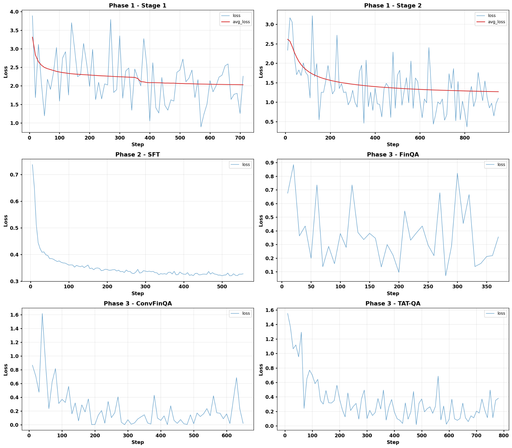

> **採択状況:** **Continual Adaptation at Scale: Towards Sustainable AI (CATS) Workshop @ ICML 2026** に採択 ([ワークショップ公式サイト](https://cats-icml.github.io/))。
>
> **GitHub リポジトリ:** [https://github.com/AtsushiYanaigsawa768/Compass](https://github.com/AtsushiYanaigsawa768/Compass)
>
> **HuggingFace Collection:** [https://huggingface.co/collections/Yana/compass](https://huggingface.co/collections/Yana/compass)
>
> **旧版（FT-LLM 2026 自由形タスク向け記事）:** [Compass (FT-LLM 2026 版)](/mysite/ja/blog/compass-ft-llm-2026/)

本記事は以前のFT-LLM 2026版を置き換える最新版である。旧版では同一モデルをFT-LLM 2026自由形タスクの枠組みで紹介していたが、本記事ではCATS Workshop @ ICML 2026 向けに、同じパイプラインを**段階的継続適応 (staged continual adaptation)** の研究として再構成し、未ファインチューン時の **Phase 0 (P0) ベースライン** を追加、外部モデル（Llama-3.3-70B、GPT-5、DeepSeek-R1、Qwen-2/3、Claude 3.5 Sonnet）との比較を新規に報告し、タスクごとの分析を更新した。旧版の数値・議論はリンク先で引き続き閲覧可能である。

本研究は [柳澤 篤](https://atsushiyanaigsawa768.github.io/mysite/en/) と [柿本 源心](https://github.com/kakimoto0225) により実施された。

---

## はじめに

多モーダル基盤モデルを特定領域に適応させる作業は、単一の学習ステップで完結することはまれである。現代的なレシピは、視覚-言語アライメント、推論蒸留、ドメイン適応を段階的に連結し、各段階は新しい能力を獲得すると同時に、既に獲得した能力を浸食する可能性がある。LLaVA系のレシピ [1, 12] はこのような多段階適応のアーキテクチャ的雛形を確立したが、対象ドメインが自由記述QAを超える構造化された予測を要求するとき、初期段階が後段とどのように相互作用するかについてはほとんど語っていない。本研究では次を問う：

> **段階的適応パイプラインの各フェーズは単調に貢献するのか、それとも段階化は能力のトレードオフを生み、最良のチェックポイントがタスクごとに異なるのか？**

我々はこれを、視覚-言語アライメント、数学的推論蒸留、金融ドメイン適応の三段階からなる**段階的継続適応**パイプラインを通じて検証する。基盤モデルはSigLIP-v2 [15] とllm-jp-4-8B-Instructを2層MLPプロジェクタ [1, 12] で接続した約8.4Bパラメータのモデルである。未ファインチューン時の指示モデルを **Phase 0 (P0)** とし、各フェーズの貢献を共通の基準で測定する。

- **Phase 1 (P1)**：既存の日本語キャプション/VQAコーパスと、政府機関（内閣府、金融庁、財務省）のPDFから合成したOCR・視覚QAを用いて、視覚と言語の表現を整列させる。
- **Phase 2 (P2)**：Qwen3-30B-A3B-Thinking-2507 [2] から chain-of-thought を蒸留する。実世界の金融タスクには非自明な数値推論が必要であるため、本フェーズを設けている。
- **Phase 3 (P3)**：テキストベース金融ベンチマーク [4, 5, 8] と、金融文書から構築した視覚QAを併用し、金融知識を文書から直接定着させる。

日本語のテストベッドとして **EDINET開示** [13] と **JP Fin Harness** [14] を採用する（EDINETは実世界の金融タスク性能を、JP Fin Harnessは日本語での金融知識を測る）。数学能力測定のため **GSM8K** [9] も併用する。**ベンチマークごとにピークに達するフェーズが異なる**ことが分かった。

**主な貢献：**

1. EDINETとJP Fin Harnessにおけるフェーズ依存の能力トレードオフを実証的に特徴付け、未ファインチューン時のベースラインに固定することで各フェーズの貢献を分解可能にした。
2. ページ画像をエンドツーエンドで処理する三段階の**段階的継続適応**パイプライン。
3. 政府PDFからOCR、視覚QA、ドメイン特化金融QAを生成する再現可能な合成データパイプライン（公開予定）。
4. Qwen3-30B-A3B-Thinking-2507 [2] からのXML構造 chain-of-thought 蒸留レシピ。

---

## アーキテクチャ

モデルは視覚エンコーダ、MLPプロジェクタ、言語モデルの3要素から構成される。


- **視覚エンコーダ：** [SigLIP-v2 SO400M-patch14-384](https://huggingface.co/google/siglip2-so400m-patch14-384) [15]、384 × 384入力から1画像あたり729パッチ（27 × 27グリッド）を生成。
- **プロジェクタ：** 2層MLP `Linear(1152 → 4096) → GELU → Linear(4096 → 4096)`（約800万パラメータ）、視覚表現と言語表現の橋渡しを担う。
- **言語モデル：** **llm-jp-4-8B-Instruct**（隠れ次元4,096、日本語事前学習済みの8Bモデル）。視覚エンコーダと合わせて総パラメータ数は約 **8.4B**。

LLaVA-OneVisionとは異なり、本モデルはAnyResマルチ解像度処理を**採用しない**。各画像は単一の384 × 384クロップ（729視覚トークン）として処理し、解像度を計算コストとトレードオフしている。詳細な比較表は[旧版記事](/mysite/ja/blog/compass-ft-llm-2026/)を参照されたい。

---

## 政府PDFからのデータ生成

本研究の中核をなす合成教師信号は、2つの情報源から得られる：日本政府機関（内閣府、金融庁、財務省）が公開するPDFと、公開された数学コーパスである。この3機関を選んだのは、金融関連資料を大量に公開しているためである。

政府PDFから、教師モデルとして **Qwen3-VL-32B-Instruct** を用い、以下の3種類の単一ページデータセットを構築する：

1. **OCRデータセット** — 各ページのテキスト書き起こし（LLaVAR [12] を参考）。
2. **抽出 + 推論VQAデータセット** — 第1ターンでページから特定要素を抽出し、第2ターンでその回答の根拠を問う（LLaVAR-2 [11] を参考）。
3. **金融特化QAデータセット** — 各ページに紐づく質問。単純抽出から多段階の数値計算まで幅広い。本データセットでは、内閣府・金融庁・財務省のウェブサイトから金融関連サブサイトを手動で同定し、ソースPDFをそれらに限定。

### 数学推論蒸留コーパス

数学データセットは、公開された6つの数学コーパス（MGSM-ja、MathInstruct、OpenMathReasoning、OpenR1-Math-220k、orca-math-word-problems-200k、NuminaMath-1.5）から、合計 **15万問** をランダムサンプリング。各問題はQwen3-30B-A3B-Thinking-2507 [2] に再アノテーションさせ、応答を `<Problem>`、`<Thinking>`、`<Answer>` タグで構造化する。このXMLフォーマットは中間推論のエラー局所化を可能にし、金融文書に頻出する多段階数値推論に適合する。

```xml
<Problem>問題の自分の言葉での再記述</Problem>
<Thinking>中間計算を含む段階的推論過程</Thinking>
<Answer>\boxed{最終的な数値解答}</Answer>
```

### データセットサイズ

| フェーズ | タイプ | 内容 | サンプル数 | タイプ計 |
|---------|--------|------|----------:|--------:|
| P1-S1 | OCR / キャプション | STAIR Captions [3] | 820,310 | **1,084,952** |
| P1-S1 | OCR / キャプション | 政府PDFからのOCR（合成）| 264,642 | |
| P1-S2 | VQA | 政府PDFからの抽出+推論QA | 264,642 | **365,137** |
| P1-S2 | VQA | JA-VG-VQA 会話型 | 99,995 | |
| P1-S2 | VQA | JA-VG-VQA-500 | 500 | |
| P2-S1 | 推論SFT | MGSM-ja、MathInstruct、OpenMathReasoning、OpenR1-Math-220k、Orca-Math-200k、NuminaMath-1.5 からランダム抽出 | ~150,000 | **~150,000** |
| P3-S1 | 金融QA | FinQA [5] + ConvFinQA [4] + TAT-QA [8] | 23,358 | **23,358** |
| P3-S2 | 視覚金融QA | 政府PDFからのドメイン特化QA | 32,484 | **32,484** |

---

## 三段階の継続適応

学習は3フェーズで進行し、未ファインチューン時のllm-jp-4-8B-InstructをP0として基準とする。

| フェーズ | 更新モジュール | 主目的 |
|---------|---------------|--------|
| **P1-S1** | プロジェクタのみ | 画像と言語埋め込みのアライメント（視覚・LLM 凍結）|
| **P1-S2** | 視覚 + プロジェクタ + LLM (LoRA r=64) | 日本語での視覚指示理解 |
| **P2-S1** | LLM (QLoRA r=32, 4-bit NF4) | 数学推論のためのchain-of-thought蒸留 |
| **P3-S1** | LLM (LoRA r=16) | テキストベース金融ドメイン適応 |
| **P3-S2** | プロジェクタ + LLM (LoRA r=16) | 政府金融文書に対する視覚ドメインQA |

**なぜこの順序か？**

- **P1が必要なのは**、事前学習済みLLMがSigLIP-v2の埋め込み空間からの画像トークンに対する事前知識を持たないため。
- **P2の動機**は、金融文書には多段階数値推論（例：表間の整合性チェック）が必要であるという観察に基づく。
- **P3で再導入**するのは、汎用的な数学蒸留が金融用語や報告慣習をカバーしないため。

### 学習ハイパーパラメータ

| ステージ | LR | バッチ | LoRA (r, α) | エポック |
|---------|----|--------|-------------|---------|
| P1-S1 | 1e-3 | 2 | なし（プロジェクタのみ）| 2 |
| P1-S2 | 2e-5 | 2 | 64, 128 | 1 |
| P1-S2B (LLM) | 1e-5 | 2 | 64, 128 | 1 |
| P1-S2B (Vision) | 2e-6 | 2 | 64, 128 | 1 |
| P2-S1 (SFT, QLoRA) | 2e-4 | 2 | 32, 64 | 1 |
| P3-S1 / P3-S2 | 5e-6 | 2 | 16, 32 | 3 |

全ステージでAdamWオプティマイザとウォームアップ付きコサインスケジューラを使用。メモリ集約的ステージではgradient checkpointingを有効化。

### 学習損失曲線



---

## 実験結果

### フェーズごとの評価（P0基準）

本論文の中核的な実証主張は、**ベンチマークごとにピークに達するフェーズが異なる**ということである（未ファインチューン時のベースラインを基準として測定）。

| ベンチマーク | **P0** | **P1** | **P2** | **P3** |
|-------------|:------:|:------:|:------:|:------:|
| GSM8K | 58.5 | 64.6 | **73.2** | 71.9 |
| EDINET earnings† | 0.524 | **0.532** | 0.500 | 0.458 |
| EDINET fraud† | 0.516 | 0.472 | 0.534 | **0.580** |
| EDINET industry | 4.7 | **8.5** | 6.9 | 6.5 |
| JP Fin Harness | 45.0 | **54.2** | 31.6 | 49.6 |

† ROC-AUC。その他はAccuracy (%)。**太字**＝各行の最良フェーズ。

- **P0 → P1** によりJP Fin Harness（45.0 → 54.2）、GSM8K（58.5 → 64.6）、EDINET industry（4.7 → 8.5）が向上。EDINET earningsはほぼ不変、**EDINET fraudのみ低下**（0.516 → 0.472）。
- **P1から**、GSM8Kは **P2で73.2まで上昇** し、P3で71.9にやや低下。**EDINET fraudはP2で回復（0.534）、P3でピーク（0.580）**。
- 残り3つのベンチマークはすべて **P1以降に低下**：JP Fin Harness（54.2 → 31.6 → 49.6）、EDINET earnings（0.532 → 0.500 → 0.458）、EDINET industry（8.5 → 6.9 → 6.5）。
- P0との比較では、**P3は5つ中4つのベンチマークでP0を上回り**、EDINET earnings（0.458 vs. 0.524）のみP0を下回る。

### JP Fin Harness タスク別内訳

| JP Fin タスク | P0 | P1 | P2 | P3-1 | P3-2 |
|--------------|:--:|:--:|:--:|:----:|:----:|
| chabsa | 0.8591 | **0.9428** | 0.5818 | 0.9357 | 0.9356 |
| cma_basics | 0.3421 | **0.5526** | 0.2105 | 0.3947 | 0.3947 |
| cpa_audit | **0.2764** | 0.2261 | 0.1683 | 0.2487 | 0.2362 |
| fp2 | 0.2989 | **0.3389** | 0.1789 | 0.2863 | 0.2989 |
| security_sales_1 | 0.4737 | **0.6491** | 0.4386 | 0.5614 | 0.6140 |
| **平均** | 0.4500 | **0.5419** | 0.3156 | 0.4854 | 0.4959 |

サブタスクの挙動は不均一：P0 → P1の改善は **chabsa**、**cma_basics**、**security_sales_1** に集中。P1以降、全サブタスクがP2で低下し、P3で **部分的にしか** 回復しない。**cpa_audit** は唯一最良スコアが **P0** にあるタスク（0.276）で、P1もP3もこれを回復できていない。

---

## 外部モデルとの比較

### EDINET

Llama-3.3-70Bは本研究と同じセットアップで評価。GPT-5とDeepSeek-R1の数値はEDINET-Bench [13] からの参考値（クロスソース、直接対決ではなく示唆的）。

| ベンチマーク | Llama-3.3-70B | GPT-5 | DeepSeek-R1 | **Ours (P3)** |
|-------------|:-------------:|:-----:|:-----------:|:-------------:|
| EDINET earnings† | 0.410 | **0.580** | 0.430 | 0.458 |
| EDINET fraud† | **0.590** | 0.560 | 0.540 | 0.580 |
| EDINET industry | 14.0 | **21.0** | 11.0 | 6.5 |

- **EDINET fraud** では、本モデルの0.580はLlama-3.3-70B（0.590）の0.01以内であり、**70B vs. 8.4B** のパラメータ数の差を考慮すると顕著な結果。
- **EDINET earnings** では、本モデルのP1ピーク（0.532）とP3チェックポイント（0.458）の両方がLlama-3.3-70B（0.410）とDeepSeek-R1（0.430）を上回るが、GPT-5（0.580）には及ばない。
- **EDINET industry** は明確な弱点：本モデルの6.5は全外部ベースライン（11.0 – 21.0）に劣る。

### JP Fin Harness

外部スコアは公式の0-shotリーダーボード [14] から取得。

| モデル | サイズ | 平均 |
|-------|:------:|:----:|
| Claude 3.5 Sonnet | proprietary | **77.0** |
| Qwen2-72B-Instruct | 72B | 67.7 |
| Qwen-14B-Chat | 14B | 49.1 |
| Meta-Llama-3-8B-Instruct | 8B | 44.7 |
| **Ours (P0)** | 8B | 45.0 |
| **Ours (P1)** | 8B | **54.2** |
| **Ours (P3)** | 8B | 49.6 |

本モデルの **P1（54.2）** はMeta-Llama-3-8B-Instruct（44.7）とQwen-14B-Chat（49.1）を上回るが、Qwen2-72B-Instruct（67.7）やClaude 3.5 Sonnet（77.0）には及ばない。**P3（49.6）** はおおむねQwen-14B-Chat（49.1）と同等。

### GSM8K

P2で使用した数学コーパスの一部にはGSM8K形式の問題が含まれており、本比較には一定のin-distributionファインチューニングが含まれる点に留意。

| モデル | GSM8K |
|-------|:-----:|
| Qwen-14B Chat | 59.3 |
| Qwen3 8B-base | **89.84** |
| Llama 3 8B | 84.5 |
| Gemma 3 4B | 89.2 |
| Ours (P0) | 58.5 |
| Ours (P1) | 64.6 |
| **Ours (P2)** | **73.2** |
| Ours (P3) | 71.9 |

本モデルのP2（73.2）はQwen-14B Chat（59.3）を上回るが、Llama 3 8B（84.5）、Gemma 3 4B（89.2）、Qwen3 8B-base（89.84）よりは11–17ポイント低い。

---

## 考察

### 能力の軌跡、終点ではなく

本評価スイートにおいて、平坦な軌跡を示すベンチマークは存在しない：**最良フェーズはベンチマークごとに異なる**。JP Fin Harness、EDINET earnings、EDINET industryは **P1** でピーク（54.2 / 0.532 / 8.5）、GSM8Kは **P2** でピーク（73.2）、EDINET fraudは **P3** でピーク（0.580）。EDINET fraudはP0 → P1で低下する唯一のベンチマーク（0.516 → 0.472）でもあり、その後回復する。

したがってデプロイ用チェックポイントの選択はタスク依存である：日本語金融ドメインの事前知識には **P1**、数学には **P2**、不正検出には **P3**。本研究では段階的継続適応を、単一の終点ではなく **P0に固定された軌跡** として扱う。

### なぜP1 → P2で金融スコアが浸食されるのか

JP Fin HarnessはP1 → P2で大幅に低下（54.2 → 31.6）し、EDINET earnings（0.532 → 0.500）・industry（8.5 → 6.9）も低下。JP Fin Harnessの全サブタスクが崩れ、エビデンス接地型の `chabsa`（0.943 → 0.582）まで巻き込まれる。

P2は chain-of-thought 教師付きの数学問題のみで学習しており、これらの低下は **破滅的忘却** と解釈できる：数学のみの大量教師付き学習が出力分布を数値chain-of-thought方向にシフトさせ、P1で獲得した日本語金融ドメインの事前知識を上書きする。**EDINET fraudは例外**（0.472 → 0.534）であり、本タスクが会計表間の数値整合性チェックに強く依存し、数学蒸留が直接的に関連する教師信号を与えるため、数学による獲得分が失われたドメイン事前知識を上回ると考えられる。

### なぜP3は部分回復にとどまり、P1に達しないのか

P3は金融教師信号を再導入して金融ベンチマークを引き上げる：JP Fin Harness 31.6 → 49.6、`chabsa` 0.582 → 0.936、EDINET fraud 0.534 → 0.580（ピーク）。しかし、JP Fin Harness、EDINET earnings、EDINET industryは依然として **P1のピークを下回り**（49.6 vs. 54.2; 0.458 vs. 0.532; 6.5 vs. 8.5）、`chabsa` も完全には回復しない（0.943 vs. 0.936）。

残る差の主因は **P3教師信号の規模が圧倒的に小さい** ことにあると考えられる：P3-S1（23,358）+ P3-S2（32,484）の合計は約56K例にとどまり、P1コーパス（P1-S1: 108万、P1-S2: 36.5万）と比べて1桁少なく、P2コーパス（約15万問）と比べてもおよそ1/3である。**P3教師信号のスケールアップが最も直接的な手段** となる。

### 文書接地型VQAの寄与

P1は金融タスクの直接的ファインチューニングではないが、学習コーパスが金融関連の政府PDFに支配されており、結果として **P0 → P1でJP Fin Harnessが45.0 → 54.2と跳ね上がる** ことは、これら政府PDFに対する文書接地型VQAが既に非自明な金融ドメイン事前知識を植え付けていることを示す。補完的な信号はP3にも見られる：テキストのみの金融ファインチューニング（P3-S1）の上に、政府PDFからの視覚ドメインQA（P3-S2）を再導入すると、JP Fin Harness平均が **0.4854 → 0.4959** に上昇する。

したがって文書接地型VQAはテキストのみの適応に対して測定可能だが控えめな効果を持つ。さらに広い改善には、抽出/推論の二分割を超えるより多様な質問タイプ、より明示的な表・グラフ接地教師信号、レイアウト認識比較を強いるより難しいディストラクタなどを含む、より意図的なVQAパイプラインが必要だろう。

---

## 制約

1. 全スコアは **単一シード** での実行値であり、フェーズ間の小さな差異は有意性検定された比較ではなく傾向として読むべきである。
2. 学習は **単一ページ入力** に限られる。実際の金融分析では有価証券報告書内の複数ページの相互参照や異なる文書間での数値比較が頻繁に必要であり、複数ページ学習は自然な拡張である。
3. **P2をスキップまたは短縮するアブレーション** により、P2での fraud 獲得が industry / earnings の犠牲に見合うかを検証する余地がある。
4. P2は **QLoRA**、他ステージはフル精度LoRAを使用しているため、量子化とP2 → P3のアダプタ受け渡しによる小さな寄与を完全には排除できない。

---

## まとめ

我々は8Bバックボーンの多モーダル基盤モデルを、政府公開PDFを用いた合成データパイプラインで学習し、未ファインチューン時のベースライン（P0）から3つの学習フェーズを通じて追跡した。

- **P0 → P1** のみでJP Fin Harnessが45.0から54.2に上昇。
- 段階的軌跡を通じて、**EDINET fraudで0.580 ROC-AUC**（P3）、**GSM8Kで73.2**（P2）を達成。
- **各ベンチマークが異なるフェーズでピークに達する**：数学蒸留はfraudを押し上げる一方、EDINET industry、earnings、分類重視のJP Fin Harnessサブタスクを浸食する。

したがってチェックポイント選択は **タスク依存** であり、段階的継続適応は単一の終点ではなく **P0に固定された軌跡** として評価するのが最も適切である ── これはCATSワークショップが焦点とする、基盤モデルの持続可能で継続的な適応というテーマに直接関連する視座である。

## 謝辞

データセット作成に使用した金融文書は、財務省、金融庁および内閣府が公開する資料であり、公共データ利用規約（PDL-1.0）に基づき利用した。計算資源として、産総研およびAIST Solutionsが提供するABCI 3.0を利用した。

## 参考文献

[1] Li, B., Zhang, Y., Guo, D., Zhang, R., Li, F., Zhang, H., Zhang, Y., Bao, Y., Li, Z., Cui, C., & Li, Y. (2024). LLaVA-OneVision: Easy Visual Task Transfer. *NeurIPS 2024*.

[2] Qwen Team. (2025). Qwen3 Technical Report. *arXiv preprint*.

[3] Yoshikawa, Y., Shigeto, Y., & Takeuchi, A. (2017). STAIR Captions: Constructing a Large-Scale Japanese Image Caption Dataset. *ACL 2017*.

[4] Chen, Z., Li, S., Smiley, C., Ma, Z., Shah, S., & Wang, W. Y. (2022). ConvFinQA: Exploring the Chain of Numerical Reasoning in Conversational Finance Question Answering. *EMNLP 2022*.

[5] Chen, Z., Chen, W., Smiley, C., Shah, S., Borova, I., & Wang, W. Y. (2021). FinQA: A Dataset of Numerical Reasoning over Financial Data. *EMNLP 2021*.

[6] Zhai, X., Mustafa, B., Kolesnikov, A., & Beyer, L. (2023). Sigmoid Loss for Language Image Pre-Training. *ICCV 2023*.

[7] Dettmers, T., Pagnoni, A., Holtzman, A., & Zettlemoyer, L. (2023). QLoRA: Efficient Finetuning of Quantized Language Models. *NeurIPS 2023*.

[8] Zhu, F., Lei, W., Huang, Y., Wang, C., Zhang, S., Lv, J., Feng, F., & Chua, T.-S. (2021). TAT-QA: A Question Answering Benchmark on a Hybrid of Tabular and Textual Content in Finance. *ACL 2021*.

[9] Cobbe, K., Kosaraju, V., Bavarian, M., Chen, M., Jun, H., Kaiser, L., Plappert, M., Tworek, J., Hilton, J., Nakano, R., Hesse, C., & Schulman, J. (2021). Training Verifiers to Solve Math Word Problems. *arXiv:2110.14168*.

[10] Hu, E. J., Shen, Y., Wallis, P., Allen-Zhu, Z., Li, Y., Wang, S., Wang, L., & Chen, W. (2022). LoRA: Low-Rank Adaptation of Large Language Models. *ICLR 2022*.

[11] Zhang, Y., Zhang, K., & Liang, X. (2024). LLaVAR-2: Large Language and Vision Assistant for Arbitrary-Resolution Image Understanding. *arXiv:2412.16364*.

[12] Zhang, Y., Zhang, R., Gu, J., Zhou, Y., Lipka, N., Yang, D., & Sun, T. (2023). LLaVAR: Enhanced Visual Instruction Tuning for Text-Rich Image Understanding. *arXiv:2306.17107*.

[13] Sugiura, I., Ishida, T., Makino, T., Tazuke, C., Nakagawa, T., Nakago, K., & Ha, D. (2026). EDINET-Bench: Evaluating LLMs on Complex Financial Tasks using Japanese Financial Statements. *ICLR 2026*. arXiv:2506.08762.

[14] Preferred Networks. japanese-lm-fin-harness. <https://github.com/pfnet-research/japanese-lm-fin-harness>

[15] Tschannen, M., Gritsenko, A., Narang, A., Zhai, X., & Beyer, L. (2025). SigLIP 2: Multilingual Vision-Language Encoders with Improved Semantic Understanding, Localization, and Dense Features. *arXiv:2502.14786*.
